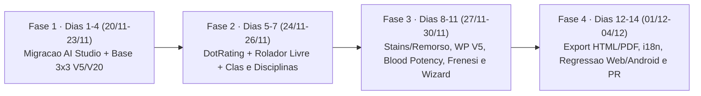

# Plano de Ação — `feat/web-wod-app` (App Web · WoD V5 + V20 em 2 Semanas)

## Goal Description

Conduzir um sprint de **2 semanas (20/11/2026 – 04/12/2026)** na branch **`feat/web-wod-app`** (criada a partir da `main` em `12c851d`) para:

1. **Integrar componentes, melhorias visuais e padrões de UI vindos do AI Studio** na arquitetura atual do **GridSheet** (React 19 + TypeScript + Vite + IndexedDB + CSS custom properties `Light` / `Dark` / `E-Ink` + `i18n` `pt-BR`/`en`/`es`).
2. **Concluir o sistema World of Darkness — Vampiro V5 e Vampiro V20 completos** no App Web, mantendo retrocompatibilidade com [schema.v2.json](file:///c:/Projetos%20teste/v1/rpg-sheet-builder/shared/presets/schema.v2.json) e [presets.v2.json](file:///c:/Projetos%20teste/v1/rpg-sheet-builder/shared/presets/presets.v2.json) para preservar o cliente Android e o pipeline de CI.

---

## Diagnóstico Atual no Código

Antes do planejamento, o código em `main` foi auditado para separar o que já está sólido do que ainda falta construir:

### Já implementado e testado em `main`
- **Motor de dados ([formula.ts](file:///c:/Projetos%20teste/v1/rpg-sheet-builder/src/core/formula.ts)):**
  - **V20:** pools d10 com Difficulty `2–10`, Especialidade (`10` vale 2), cancelamento por `1`, Botch, Soak (`bashing`/`lethal`/`aggravated`) e `+1` sucesso automático por Força de Vontade.
  - **V5:** sucesso fixo `>= 6` no dado, *Target Successes* (`1–10`), cálculo de Margem, Crítico / *Messy Critical*, Falha / *Bestial Failure*, *Rouse Check*, bônus de *Blood Surge* por *Blood Potency* e reroll seletivo com Força de Vontade bloqueando dados de Fome.
- **Motor de XP ([xpSystem.ts](file:///c:/Projetos%20teste/v1/rpg-sheet-builder/src/core/xpSystem.ts)):** regras V20, V5 e Custom, multiplicadores Clã/Fora de Clã, compra direta de Especializações (`3 XP`) e Antecedentes, histórico e *Undo*.
- **Catálogo oficial de perícias ([wodSkillsCatalog.ts](file:///c:/Projetos%20teste/v1/rpg-sheet-builder/src/core/wodSkillsCatalog.ts)):** 30 Habilidades oficiais V20 (`10/10/10`) e 27 Perícias oficiais V5 (`9/9/9`) localizadas em `pt-BR`, `en` e `es`, integradas a [BentoCard.tsx](file:///c:/Projetos%20teste/v1/rpg-sheet-builder/src/components/BentoCard.tsx) e [CustomCardBuilder.tsx](file:///c:/Projetos%20teste/v1/rpg-sheet-builder/src/components/CustomCardBuilder.tsx).
- **Vitalidade, Persistência e Consulta Offline ([sheetModel.ts](file:///c:/Projetos%20teste/v1/rpg-sheet-builder/src/core/sheetModel.ts), [sheetsStore.ts](file:///c:/Projetos%20teste/v1/rpg-sheet-builder/src/core/sheetsStore.ts), [pdfRulesStore.ts](file:///c:/Projetos%20teste/v1/rpg-sheet-builder/src/core/pdfRulesStore.ts)):** trilha de Vitalidade 3 estados (V20) e 2 estados com metade/overflow (V5), Blood Pool por Geração, Virtudes (V20), Fome `0–5` (V5), IndexedDB, snapshots, exportação JSON/HTML e busca offline de PDFs.

### Lacunas para concluir Vampiro V5 + V20 no App Web
1. **Grade de 9 Atributos (3×3) incompleta nos presets ([presets.v2.json](file:///c:/Projetos%20teste/v1/rpg-sheet-builder/shared/presets/presets.v2.json)):** o preset atual traz apenas 6 atributos (`strength`, `dexterity`, `stamina`, `charisma`, `manipulation`, `wits`). Faltam:
   - **V20:** `Appearance`, `Perception`, `Intelligence`.
   - **V5:** `Composure`, `Intelligence`, `Resolve` (além da derivação `Health = Stamina + 3` e `Willpower = Composure + Resolve`).
2. **Identidade & Crônica:** faltam campos essenciais (`Conceito`, `Senhor`, `Crônica`, `Natureza`/`Comportamento`/`Fraqueza de Clã` no V20; `Tipo de Predador`, `Ambição`, `Desejo`, `Perdição`/`Compulsão de Clã` no V5) e seleção clara de edição (`V5` vs `V20`) e Clã já na criação da ficha.
3. **UX idiomática de WoD:**
   - Controle visual de **bolinhas (`DotRating` `●●●●○`)** clicável/acessível para Atributos, Perícias, Disciplinas e Antecedentes.
   - **Rolador Combinado livre** (`Atributo + Habilidade/Disciplina + Modificador + Dificuldade + WP/Surge/Fome`) para jogadas improvisadas em mesa.
4. **Catálogo de Clãs e Disciplinas (V20 + V5):** seleção de Clã marcando afinidade automática no `xpSystem.ts` e poderes/rituais estruturados com acionamento direto de *Rouse Check* / *Blood Pool*.
5. **Mecânicas vampíricas faltantes:**
   - **V5:** **Manchas (*Stains*) na Humanidade + Teste de Remorso**, **Força de Vontade com dano Superficial + Agravado + estado *Impaired***, **Tabela de Potência de Sangue** (Surge, Cura, Bônus de Poder, Re-rolagem de Rouse, Perdição, Alimentação) e **Pedras de Toque & Convicções**.
   - **V20 + V5:** **Rolagem dedicada de Frenesi / Rötschreck**, gestão estruturada de **Qualidades, Defeitos, Antecedentes e Refúgios**, e **Assistente opcional de Criação de Personagem WoD**.
6. **Exportação, Impressão & Paridade:** atualização de [pureHtmlExporter.ts](file:///c:/Projetos%20teste/v1/rpg-sheet-builder/src/core/pureHtmlExporter.ts), CSS `@media print`, paridade 100% em `pt-BR`/`en`/`es` e sincronia retrocompatível do contrato compartilhado (`schema.v2.json` + Android `SheetPayloadValidator`).

---

## User Review Required

> [!IMPORTANT]
> **Branch ativa pronta, código-fonte intocado até sua aprovação:**
> - A branch **`feat/web-wod-app`** foi criada a partir de `main` (`12c851d`), mas **nenhum arquivo de código do projeto será editado** antes da sua aprovação deste plano e do envio/indicação dos componentes/UI vindos do **AI Studio** para abrir a Fase 1.
> - Todas as evoluções em `shared/presets/schema.v2.json` e `shared/presets/presets.v2.json` permanecerão **retrocompatíveis** com o app Android e validadas pelo `SheetPayloadValidator` e `SharedFixturesTest`.

---

## Cronograma de 2 Semanas (20/11/2026 – 04/12/2026)



---

## Proposed Changes

### Fase 1 — Migração de Componentes/UI do AI Studio + Estrutura Completa V5/V20 (Dias 1–4)

Integrar os componentes e melhorias visuais do AI Studio ao design system do GridSheet (`Light`, `Dark`, `E-Ink`) e completar a estrutura base das fichas Vampiro V5 e V20.

#### [MODIFY] Componentes migrados do AI Studio & estilos (`src/components/*`, [index.css](file:///c:/Projetos%20teste/v1/rpg-sheet-builder/src/index.css), [App.tsx](file:///c:/Projetos%20teste/v1/rpg-sheet-builder/src/App.tsx))
- Adaptar os componentes visuais recebidos do AI Studio para usar os tokens CSS do GridSheet (`--bg-card`, `--accent-primary`, `--accent-wine`, `--border-color`, etc.), preservar acessibilidade (`useFocusTrap`, foco por teclado) e remover qualquer dependência/integração obsoleta de API externa (ex.: `@google/genai`).
- Centralizar todos os textos da UI nova em [i18n.ts](file:///c:/Projetos%20teste/v1/rpg-sheet-builder/src/core/i18n.ts).

#### [MODIFY] [presets.v2.json](file:///c:/Projetos%20teste/v1/rpg-sheet-builder/shared/presets/presets.v2.json), [schema.v2.json](file:///c:/Projetos%20teste/v1/rpg-sheet-builder/shared/presets/schema.v2.json), [sheetModel.ts](file:///c:/Projetos%20teste/v1/rpg-sheet-builder/src/core/sheetModel.ts) e [SheetModels.kt](file:///c:/Projetos%20teste/v1/rpg-sheet-builder/android/app/src/main/java/com/gridsheet/app/core/SheetModels.kt)
- Completar a grade **3×3 de Atributos** (9 atributos físicos/sociais/mentais) e atualizar os campos de **Identidade & Crônica** específicos de **V20** (`nature`, `demeanor`, `clan_weakness`, `sire`, `concept`, `chronicle`) e **V5** (`predator_type`, `ambition`, `desire`, `clan_bane`, `clan_compulsion`, `sire`, `concept`, `chronicle`).
- Adicionar ao V5 as fórmulas derivadas padrão (`health = stamina + 3`, `willpower = composure + resolve`) sem quebrar fichas legadas na migração (`migrateLegacyWodSheet`).
- Manter propriedades novas no `schema.v2.json` como opcionais e sincronizar `SheetPayloadValidator` no Android.

#### [MODIFY] [HomeView.tsx](file:///c:/Projetos%20teste/v1/rpg-sheet-builder/src/components/HomeView.tsx) e [SheetModal.tsx](file:///c:/Projetos%20teste/v1/rpg-sheet-builder/src/components/SheetModal.tsx)
- Permitir escolher explicitamente a edição (**Vampiro V5** vs **Vampiro V20**) e o **Clã** logo ao criar uma nova ficha WoD, inicializando automaticamente o `rulePreset`, atributos da edição, trilha de dano e campos de identidade correspondentes.

---

### Fase 2 — UX Core de WoD: Dots, Rolador Combinado & Catálogo de Clãs/Disciplinas (Dias 5–7)

Entregar os fluxos essenciais de jogo em mesa para V5 e V20.

#### [NEW] `src/components/DotRating.tsx`
#### [MODIFY] [FieldPrimitives.tsx](file:///c:/Projetos%20teste/v1/rpg-sheet-builder/src/components/FieldPrimitives.tsx) e [BentoCard.tsx](file:///c:/Projetos%20teste/v1/rpg-sheet-builder/src/components/BentoCard.tsx)
- Criar o componente acessível **`DotRating`** (`●●●●○`, escala `0–5` e `0–10`) com clique/toque para alterar nível (clicar no dot ativo atual reduz para `N-1`, permitindo zerar quando aplicável), navegação por teclado (`ArrowLeft`/`ArrowRight`) e contraste consistente nos temas `Light`, `Dark` e `E-Ink`.
- Aplicar `DotRating` em Atributos, Perícias, Disciplinas, Virtudes e Antecedentes em modo Jogo, preservando edição rápida de valor.

#### [NEW] `src/components/WodPoolComposer.tsx`
#### [MODIFY] [RollLogSidebar.tsx](file:///c:/Projetos%20teste/v1/rpg-sheet-builder/src/components/RollLogSidebar.tsx) e [App.tsx](file:///c:/Projetos%20teste/v1/rpg-sheet-builder/src/App.tsx)
- Criar um **Rolador Combinado livre** para WoD permitindo combinar em 2 cliques: `Atributo` + `Perícia/Disciplina/Virtude` + `Modificador` + `Dificuldade` (`TN` no V20 / `Meta` no V5), respeitando automaticamente penalidade de ferimento, *Blood Surge*, dados de Fome e gasto de `+1 Willpower` (V20).

#### [NEW] `src/core/wodClansDisciplinesCatalog.ts` e `src/core/wodClansDisciplinesCatalog.test.ts`
#### [MODIFY] [xpSystem.ts](file:///c:/Projetos%20teste/v1/rpg-sheet-builder/src/core/xpSystem.ts) e [vitest.config.ts](file:///c:/Projetos%20teste/v1/rpg-sheet-builder/vitest.config.ts)
- Catalogar **Clãs oficiais V20 e V5** (com Disciplinas de Clã, Perdição/Fraqueza e Compulsão) e **Disciplinas + Poderes principais**.
- Integrar com o [xpSystem.ts](file:///c:/Projetos%20teste/v1/rpg-sheet-builder/src/core/xpSystem.ts) para identificar automaticamente Disciplinas **de Clã** (`×5`) vs **Fora de Clã** (`×7`) conforme o Clã selecionado na ficha (mantendo override manual por campo).
- Adicionar suporte nos cartões de Disciplinas/Poderes para acionar **Rouse Check** (V5) ou **Gasto de Sangue** (V20) direto da ficha.
- Registrar o novo teste `node:test` na lista `test.exclude` de [vitest.config.ts](file:///c:/Projetos%20teste/v1/rpg-sheet-builder/vitest.config.ts).

---

### Fase 3 — Mecânicas Avançadas (V5 + V20) & Criação Guiada (Dias 8–11)

Cobrir as mecânicas vampíricas de mesa que hoje dependem de controle manual fora da ficha.

#### [MODIFY] [formula.ts](file:///c:/Projetos%20teste/v1/rpg-sheet-builder/src/core/formula.ts), [sheetModel.ts](file:///c:/Projetos%20teste/v1/rpg-sheet-builder/src/core/sheetModel.ts), [formula.test.ts](file:///c:/Projetos%20teste/v1/rpg-sheet-builder/src/core/formula.test.ts) e [sheetModel.test.ts](file:///c:/Projetos%20teste/v1/rpg-sheet-builder/src/core/sheetModel.test.ts)
- **Humanidade, Manchas (*Stains*) e Remorso (V5):**
  - Rastrear `stains` na trilha de 10 caixas de Humanidade (evitando ultrapassar caixas livres e sinalizando *Degeneration*).
  - Implementar função pura `executeRemorseCheck(...)` (`(10 - humanity - stains)` dados ou `1` dado mínimo; falha reduz Humanidade em `1` e limpa Manchas; sucesso limpa Manchas).
- **Força de Vontade Completa (V5):**
  - Rastrear dano `superficialDamage` e `aggravatedDamage` também no campo `willpower` no V5 (como já existe em `health`), aplicando estado *Impaired* (`-2` em paradas sociais/mentais aplicáveis ou badge explícito) quando cheia e diferenciando dano por gasto/reroll de WP.
- **Tabela de Potência de Sangue (V5):**
  - Função determinística `getV5BloodPotencyStats(bp)` retornando: Dados de *Blood Surge*, Cura por *Rouse*, Bônus de Poder, Nível máximo de *Rouse Reroll*, Severidade da Perdição (*Bane Severity*) e Penalidade de Alimentação.
- **Frenesi & Rötschreck (V20 + V5):**
  - Helper e atalho rápido para testes de Frenesi (V5: `Willpower + ⌊Humanidade / 3⌋` sem dados de Fome; V20: rolagem de Autocontrole / Instinto / Coragem com dificuldade configurável).

#### [MODIFY] [BentoCard.tsx](file:///c:/Projetos%20teste/v1/rpg-sheet-builder/src/components/BentoCard.tsx) e [FieldPrimitives.tsx](file:///c:/Projetos%20teste/v1/rpg-sheet-builder/src/components/FieldPrimitives.tsx)
- Renderizar na UI: caixa dupla de Humanidade + Manchas + botão **Teste de Remorso**, trilha de Willpower V5 (Superficial/Agravado), painel compacto de **Potência de Sangue**, atalho de **Frenesi/Rötschreck** e blocos estruturados para **Pedras de Toque / Convicções**, **Qualidades / Defeitos** e **Antecedentes / Refúgios**.

#### [NEW] `src/components/WodCreationWizard.tsx`
#### [MODIFY] [SheetModal.tsx](file:///c:/Projetos%20teste/v1/rpg-sheet-builder/src/components/SheetModal.tsx)
- Assistente guiado opcional ao criar personagem WoD: **Passo 1** (Edição V5/V20 + Clã + Identidade) → **Passo 2** (Priorização/distribuição de Atributos `4/3/2` no V5 ou `7/5/3` no V20) → **Passo 3** (Perícias/Habilidades) → **Passo 4** (Disciplinas iniciais, Antecedentes/Predador e Vitalidade/Humanidade/Potência de Sangue iniciais).

---

### Fase 4 — Polimento, Exportação HTML/PDF, i18n & Entrega (Dias 12–14)

#### [MODIFY] [pureHtmlExporter.ts](file:///c:/Projetos%20teste/v1/rpg-sheet-builder/src/core/pureHtmlExporter.ts) e [index.css](file:///c:/Projetos%20teste/v1/rpg-sheet-builder/src/index.css)
- Atualizar o exportador HTML standalone e os estilos de impressão PDF para exibir `DotRating`, trilha de Manchas/Willpower V5, dados de Potência de Sangue e identidade/disciplinas com alto contraste em impressão.

#### [MODIFY] [i18n.ts](file:///c:/Projetos%20teste/v1/rpg-sheet-builder/src/core/i18n.ts) e [i18n.test.ts](file:///c:/Projetos%20teste/v1/rpg-sheet-builder/src/i18n.test.ts)
- Garantir 100% das novas chaves traduzidas e não vazias em `pt-BR`, `en` e `es`.

#### Revisão Final & Preparação para Merge em `main`
- Revisão completa de responsividade (Desktop + Mobile), foco/teclado e temas (`Light`, `Dark`, `E-Ink`).
- Validação de regressão no Android para qualquer alteração feita em `shared/presets/`.

---

## Verification Plan

### Automated Tests (executados ao fim de cada fase e antes do merge para `main`)
1. **Typecheck:**
   ```powershell
   npm run lint
   ```
2. **Testes Vitest (i18n, IndexedDB, PDF rules store, fixtures compartilhadas):**
   ```powershell
   npm run test:vitest
   ```
3. **Testes `node:test` (fórmulas V20/V5, catálogos WoD, modelo da ficha, XP, sync, temas):**
   ```powershell
   npm run test:node
   ```
4. **Build de produção Web:**
   ```powershell
   npx vite build --base=/rpg-sheet-builder/
   ```
5. **Regressão Android (obrigatório após mudanças em `shared/presets/` ou `SheetModels.kt`):**
   ```powershell
   .\android\gradlew.bat -p android testDebugUnitTest --no-daemon
   ```

### Manual Verification
- Verificar imediatamente após esta etapa que `git status -sb` e `git branch -vv` confirmam a branch `feat/web-wod-app` apontando para `origin/feat/web-wod-app` em `12c851d`.
- A cada fase implementada, testar no navegador em **Desktop** e **Mobile**, nos **3 temas** (`CLARO`, `ESCURO`, `E-INK`) e nos **3 idiomas** (`pt-BR`, `en`, `es`):
  - Criação de ficha V5 e V20 (com Clã e 9 Atributos);
  - Alteração de Dots, rolagens combinadas, Fome / *Messy Critical* / *Bestial Failure*, Remorso, Força de Vontade V5, Frenesi e Soak V20;
  - Compra de XP (Clã vs Fora de Clã, Especialização, Antecedente) e Undo;
  - Exportação JSON, HTML standalone e visualização de impressão PDF.
